# MODULE DEPENDENCIES & IMPACT MATRIX: Kasyap Diamond ERP

> **MANDATORY WORKING CONDITION:**
> - **Before modifying any shared file, consult this impact matrix to identify every dependent module.**
> - **After modifying any shared file, execute the regression tests outlined in `REGRESSION_TESTS.md` across all identified dependent modules.**
> - **Never sacrifice existing functionality for a quick fix.**

---

## 1. Core Shared Files & Dependent Module Map

```mermaid
graph TD
    HELPERS["includes/helpers.php\n(Calculations, 9-Pillars, Formatters, Icons)"]
    AUTH["includes/auth.php\n(RBAC, Session Timeout, Authentication)"]
    CSRF["includes/csrf.php\n(Token Generation, hash_equals Validation)"]
    DB["config/database.php\n(PDO Singleton Connection)"]
    CSS["assets/css/diamond.css\n(Design Tokens, Gujarati Typography)"]

    ROUGH["modules/rough/*\n(Purchases, Sales, Lots)"]
    ASSORT["modules/assort/*\n(Splitting, Parts, Loss)"]
    KAPAN["modules/kapan/*\n(Production, Packets)"]
    POLISH["modules/polish/*\n(Hub, Stock, Trade)"]
    FINANCE["modules/finance/*\n(Schedule, Payables, Ledger)"]
    DASHBOARD["modules/dashboard/*\n(Executive KPIs)"]
    PROCESS["modules/process/*\n(Barcode, Stages)"]

    HELPERS --> ROUGH & ASSORT & KAPAN & POLISH & FINANCE & DASHBOARD & PROCESS
    AUTH --> ROUGH & ASSORT & KAPAN & POLISH & FINANCE & DASHBOARD & PROCESS
    CSRF --> ROUGH & ASSORT & KAPAN & POLISH & FINANCE & PROCESS
    DB --> ROUGH & ASSORT & KAPAN & POLISH & FINANCE & DASHBOARD & PROCESS
    CSS --> ROUGH & ASSORT & KAPAN & POLISH & FINANCE & DASHBOARD & PROCESS
```

---

## 2. Shared File In-Depth Impact Analysis

### 2.1 `includes/helpers.php` (4,000+ Lines)
This is the central nervous system of the ERP. A single breaking change or unhandled exception here cascades across the entire software.
- **Key Functions & Consumers:**
  | Function Name | Description | Dependent Modules | Regression Risk |
  |:---|:---|:---|:---:|
  | `get_filter_period_dates()` | Resolves FY, Month, Today, Custom date bounds | `modules/rough/index.php`, `modules/polish/index.php`, `modules/reports/summary.php` | **HIGH**: Bad return breaks date filtering and crashes aggregates. |
  | `get_trade_and_stock_9_pillars()` | Master executive aggregates (Rough, GIA, Parcel: Buy, Sell, Stock) | `modules/reports/summary.php`, `modules/dashboard/index.php` | **CRITICAL**: Modifying WHERE clauses impacts physical vs merged inventory totals. |
  | `is_stand_dollar()` | Detects Stand Dollar USD transactions | `modules/finance/schedule.php`, `modules/finance/receivables.php`, `modules/reports/export.php` | **HIGH**: Currency misclassification corrupts INR vs USD balance sheets. |
  | `format_carat()` / `format_currency()` | Formats numbers (3 decimals for Ct, 2 for INR) | All 100 modules | **MEDIUM**: Layout breaks if string return changes. |
  | `svg_icon()` | Renders inline SVG icons | All modules and templates | **LOW**: UI icon missing if key renamed. |

---

### 2.2 `includes/auth.php`
Governs user session security, login state, and role permissions.
- **Key Functions & Consumers:**
  | Function Name | Description | Dependent Modules | Regression Risk |
  |:---|:---|:---|:---:|
  | `require_login()` | Redirects unauthenticated visitors to `login.php` | Every module entry script | **CRITICAL**: Failure allows unauthorized access. |
  | `require_role(array $roles)` | Enforces role access (`admin`, `manager`, `operator`) | `modules/admin/*`, `modules/*/delete.php`, `modules/admin/backup.php` | **HIGH**: Privilege escalation if bypassed; access denied to legitimate managers if broken. |
  | `current_user()` | Fetches active user session array | Audit logging, header navbar, permission checks | **HIGH**: Returns null if session expired. |
  | `login_user()` | Verifies credentials with `password_verify` | `login.php` | **CRITICAL**: Broken auth halts company operations. |

---

### 2.3 `includes/csrf.php`
State-changing attack prevention.
- **Key Functions & Consumers:**
  - `csrf_token()`: Injected as `<input type="hidden" name="csrf_token" ...>` into every HTML form.
  - `validate_csrf()`: Called in every `POST` controller before executing queries.
  - `ajax_update_stage.php`: Validates token via `hash_equals($_SESSION['csrf_token'], $csrfToken)`.
- **Regression Checklist:**
  - Always ensure `session_start()` has executed before calling `csrf_token()`.
  - Always check AJAX header `HTTP_X_CSRF_TOKEN` or JSON body for async requests.

---

### 2.4 `config/database.php`
- **Singleton PDO instance:** `getDbConnection()`.
- **Dependent Modules:** All 100 PHP files.
- **Rule:** Never execute raw unbuffered multi-queries without transaction isolation.

---

### 2.5 `assets/css/diamond.css`
- **Custom Properties (Design Tokens):**
  - `--kasyap-navy-primary: #0B192C`
  - `--kasyap-gold-primary: #FFB200`
  - `--kasyap-font-family: 'Noto Sans Gujarati', sans-serif`
  - Card radius, button heights (>= 44px for barcode scanning usability), tabular numerals.
- **Rule:** Never hardcode inline colors or arbitrary px units where a standard CSS variable exists.

---

## 3. Database Table Cross-Module Dependencies

| Database Table | Written By (Writers) | Read By (Readers) |
|:---|:---|:---|
| `rough_purchases` | `modules/rough_purchase/create.php`, `edit.php`, `import.php`, `merge.php` | `modules/rough/index.php`, `modules/assort/index.php`, `modules/kapan/create.php`, `modules/finance/*`, `modules/dashboard/*` |
| `assort_tasks` & `assort_parts` | `modules/assort/create.php`, `edit.php` | `modules/assort/index.php`, `modules/kapan/create.php`, `modules/rough/index.php` |
| `kapans` & `packets` | `modules/kapan/create.php`, `modules/process/ajax_update_stage.php`, `modules/boil/*` | `modules/kapan/index.php`, `modules/process/*`, `modules/stock/index.php`, `modules/dashboard/index.php` |
| `polish_stocks` | `modules/polish_stock/create.php`, `modules/polish_purchase/*`, `modules/process/` | `modules/polish/index.php`, `modules/polish_sales/create.php`, `modules/stock/index.php` |
| `parties` | `modules/parties/create.php`, `edit.php` | All purchase, sale, brokerage, and finance modules |

---

## 4. Pre-Modification Checklist for Developers / Agents

Before making any modification to a shared file:
- [ ] 1. Look up the file in Section 2 above to identify all consumers.
- [ ] 2. Check `BUG_REGISTER.md` to ensure the planned approach hasn't previously failed.
- [ ] 3. Verify function signatures and parameter types (`declare(strict_types=1)` compatibility).
- [ ] 4. Check for nullability and edge cases (e.g., `false` returns from `strtotime`, `empty` arrays).
- [ ] 5. Run PHP syntax validation: `php -l <file>` on all modified files.
- [ ] 6. Execute dependent module regression tests from `REGRESSION_TESTS.md`.
- [ ] 7. Update `CHANGELOG.md` and `BUG_REGISTER.md` upon completion.
